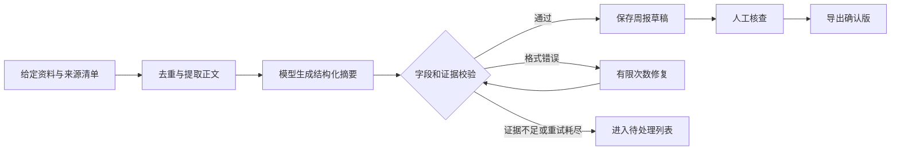

# AI 辅助工作流：把一次好回答变成可重复流程

[返回首页](../README.md) · [资源总表](05-resource-catalog.md)

适合已会提示词、表格或基本脚本，希望把资料整理、报告、知识库与工具操作连接起来的人。核心能力是明确流程的状态、输入输出和失败处理。

## 两条入口

| 路线 | 资源与阅读入口 | 适用情况 | 最先练什么 |
| --- | --- | --- | --- |
| 可视化 | [Langflow](https://github.com/langflow-ai/langflow)，README 的 visual builder、API/export、MCP | Python 较弱，想先看懂信息如何流动 | 输入 → 提取结构 → 校验 → 人工检查 → 导出 |
| 代码 | [LangGraph](https://github.com/langchain-ai/langgraph)，官方教程中的状态图、持久化、interrupt | 会 Python，希望精确控制条件与恢复 | 给流程加入暂停、恢复和失败分支 |

希望了解小型 Agent 执行机制，可读 [smolagents](https://github.com/huggingface/smolagents)；偏 .NET 或 Python 企业集成，可读 [Microsoft Agent Framework](https://github.com/microsoft/agent-framework) 的 provider 和 workflow samples。第一轮不必同时学习所有框架。

## 进阶知识的依赖顺序

1. **结构化输出**：把“总结这份材料”改为约定 JSON 字段，例如标题、来源、结论、证据、待确认项。校验字段类型和必填项，空值有明确含义。
2. **状态与分支**：区分待处理、成功、证据不足、格式错误、工具失败、待人工确认，避免所有异常都落入“再问一次模型”。
3. **检索与引用**：保留原始来源、段落或页码；让摘要能定位证据，给找不到支持材料的结论留空。
4. **工具接口**：用 [MCP Python SDK](https://github.com/modelcontextprotocol/python-sdk) 学习 tool、resource 与 schema。先做只读的“查询本地资料索引”工具，再考虑写入动作。
5. **评测与观察**：用 [Promptfoo](https://github.com/promptfoo/promptfoo) 比较提示与模型；用 [Langfuse](https://github.com/langfuse/langfuse) 开源核心记录 trace、耗时和成本。Langfuse 的企业目录另有许可。
6. **优化与扩展**：有稳定的任务和评分后，再使用 [DSPy](https://github.com/stanfordnlp/dspy) 优化模块，或者增加多个 Agent。

## 设计一次“资料周报”流程

先使用自备的 5—10 份公开文本；暂时从固定输入读取，减少抓取网页、登录和反爬带来的额外变量。样例至少包括重复材料、缺失正文、互相冲突的信息和一份含有“忽略规则”等指令的外部文本。

外部材料是待分析数据。若其中有要求修改系统行为、读取密钥或调用无关工具的文字，应作为文本内容处理。工具调用仍依据用户任务与授权；这样可以实际测量流程处理不可信资料的表现。

## 三个工程细节

**重试有上限。** 网络失败可以重试，证据缺失通常需要补材料。设置最多两次格式修复，达到上限进入人工队列；每次调用都计入成本。

**重复输入不重复执行写操作。** 为来源或任务生成稳定标识，记录处理状态。重复运行时复用成功结果或覆盖同一草稿，避免产生两份外发消息。

**把外发放在清楚的边界。** 第一版只保存本地草稿。将来接入邮件或办公平台时，先预览收件人、正文和附件，再由用户明确确认发送。

## 可交付练习

填写[工作流模板](../templates/workflow-spec.md)，交付流程图、一个配置/代码导出、10 条带预期行为的样例、成功与失败运行记录，以及一次修改前后的评估。

验收：同一输入重复运行不重复产生副作用；格式错误和证据不足走不同分支；人工能定位每条结论的来源；记录至少一轮真实耗时与调用量。

## 源码可用平台怎样选

[n8n](https://github.com/n8n-io/n8n) 的外部系统集成丰富，适合研究连接器和触发器；其 Sustainable Use License 包含使用限制。[Dify](https://github.com/langgenius/dify) 适合观察应用、知识库和工作流的一体化体验，使用附加条款限制多租户和标识处理。两者可以作为有价值的学习参考；部署和再分发前阅读各自许可。本指南严格开源的可视化首选为 MIT 许可的 Langflow。
